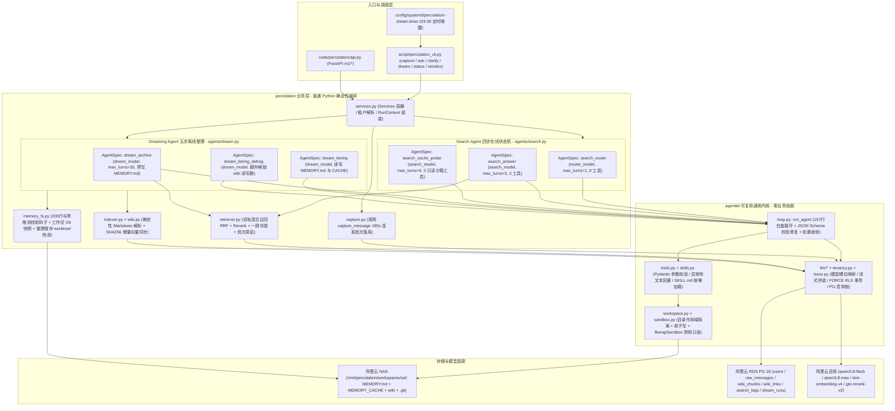
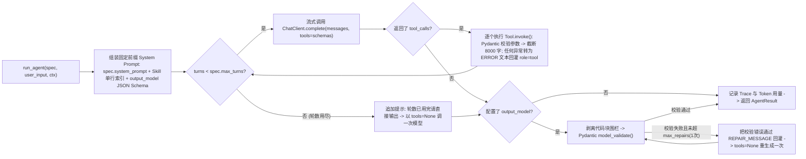

# Agent 核心（agentkit）与总体分层架构

本文记录 Percolation 智能体系统的总体分层架构，以及通用内核 `code/agentkit/` 的核心设计与单节点工具循环机制。

---

## 一、 分层设计原则

系统严格切分为四层，核心边界只有一条：**凡是出现业务表名、业务目录名或业务提示词的逻辑，一律留在业务层；凡是与具体业务无关的模型交互、工具调度、沙箱隔离与多租户上下文，一律沉淀在 `agentkit`**。

1. **入口与调度层**：命令行 `script/percolation_cli.py`、HTTP 服务 `code/percolation/api.py`、夜间定时任务 `config/systemd/percolation-dream.timer`。仅负责参数校验、租户标识解析与调用业务编排函数。
2. **`percolation` 业务层（确定性状态机编排）**：不引入任何黑盒图框架或自定义 DSL，直接用普通 Python `if / for / await` 编写 `Search Agent`（四步在线检索）与 `Dreaming Agent`（五步夜间整理）的主干控制流；只在需要语义理解与工具探索的节点上定义独立的 `AgentSpec` 并调用 `run_agent()`。
3. **`agentkit` 通用内核（零业务依赖）**：封装多模型槽位注册表、流式聊天/向量/重排客户端、157 行白盒工具循环、Pydantic 结构化输出校验与修复、`SKILL.md` 按需加载、受限目录文件工具工厂、`Bubblewrap` 内核命名空间沙箱、PostgreSQL 强制 RLS 事务上下文与追踪日志。
4. **云存储与模型底座**：阿里云广州通用型 NAS（承载各租户独立工作区与本地 Git 仓库）、阿里云 RDS PostgreSQL 18 独立库（承载只追加原话、混合索引与遥测账本）、阿里云百炼与火山方舟多模型通道。

---

## 二、 总体架构图（内核 + 两个业务 Agent）



---

## 三、 `agentkit` 核心模块与原语设计

### 1. 静态声明与动态上下文分离：`AgentSpec` vs. `RunContext`

- **`AgentSpec`（`code/agentkit/agent.py`）**：不可变的冻结数据类（`frozen=True`），完整声明一个智能体节点的静态契约：
  - `name`：节点唯一名称（用于追踪事件归属）；
  - `model_slot`：逻辑模型槽位名（如 `router_model`、`search_model`、`dream_model`），与具体厂商模型解耦；
  - `system_prompt`：静态系统提示词，运行期前缀恒定不变，最大化命中大模型服务端 KV Cache；
  - `tools`：该节点被授予的最小 `Tool` 元组；
  - `output_model`：可选的 Pydantic `BaseModel` 子类，用于强制约束最终输出结构；
  - `max_turns` / `max_repairs`：最大工具轮数与结构化输出校验失败后的最大自动修复次数（默认 1 次）；
  - `skills_dir`：可选的技能目录路径，非空时自动注入单行技能目录与 `read_skill` 工具。
- **`RunContext`（`code/agentkit/context.py`）**：单次请求的运行期资源容器，持有 `tenant_id`、`models`、`workspace`、`sandbox`、`trace` 以及业务依赖槽 `deps`。**所有工具处理函数只能从 `ctx` 获取外部资源**，从根源上杜绝全局变量导致的跨租户串数据。

### 2. 157 行白盒工具循环：`run_agent`

`code/agentkit/loop.py` 实现了无黑盒魔法的标准循环，流程图如下：



关键工程保障：
- **全流式拼装（`llm/chat.py`）**：部分国产推理模型（如开启 `enable_thinking: true` 时的千问 Max）强制要求 `stream: true`。客户端统一采用 SSE 流式接收，按 `delta.tool_calls[].index` 将分片拼回完整的函数名与 JSON 参数，并从尾帧提取包含 `cached_tokens` 与 `reasoning_tokens` 的精确用量。
- **工具异常永不崩循环（`tools.py`）**：参数非合法 JSON、Pydantic 字段校验失败、路径越界报错或内部异常，全部由 `Tool.invoke()` 捕获并格式化为 `ERROR: ...` 字符串回灌给模型，让模型自行修正参数或换用其他路径。工具正常返回超过 `8000` 字符时自动截断并附带字数提示，防止单次大输出撑爆上下文。
- **超轮数优雅收敛**：当模型连续调用工具达到 `max_turns` 仍未停止时，不直接抛异常丢弃前序工作，而是追加 `EXHAUSTED_MESSAGE` 并以 `tools=None` 再请求一次模型，强制其基于已收集到的证据给出结论。
- **结构化输出自愈**：解析最终 JSON 时自动容忍 ` ```json ` 围栏与首尾杂散字符；若不符合 `output_model` Schema，将具体校验错误回灌给模型修复一次，大幅降低偶发格式抖动导致的失败率。

### 3. 受限工作区与内核级沙箱：`Workspace` + `BwrapSandbox`

- **`Workspace`（`code/agentkit/workspace.py`）**：
  - 统一对传入路径剥离 `/workspace` 前缀并执行 `Path.resolve()`，严格校验目标路径位于租户根目录（以及可选的 `scope` 子目录）之内，且自动屏蔽 `.git` 与 `.tmp-*` 临时文件。
  - `write_atomic()` 先写入同目录临时文件再调用 `os.replace()` 原子替换，确保并发读取方永远不会读到写了一半的残缺文件。
  - `workspace_tools()` 工厂支持按节点角色组合 `scope`、`writable`、`write_prefixes`、`allow_delete` 与自定义写入校验钩子 `validators`。
- **`BwrapSandbox`（`code/agentkit/sandbox.py`）**：
  - 实现 `SandboxExecutor` 协议（未来多机扩容时可无缝替换为阿里云云端沙箱实现）。
  - 执行参数：`bwrap --unshare-all --die-with-parent --new-session --clearenv`，只读挂载系统基础运行库，`/tmp` 挂载为内存 `tmpfs`，租户目录通过 `--ro-bind` 只读挂载到 `/workspace`（当配置了 `scope="MEMORY_CACHE"` 时，沙箱内甚至连同一租户的 `MEMORY.md` 和 `wiki/` 都完全不可见），断绝网络访问与宿主机密钥泄漏风险。

### 4. 数据库强制 RLS 事务与会话级咨询锁：`tenancy.py`

- **`tenant_tx(pool, tenant_id)`**：从连接池借出连接开启事务后，首条语句固定执行 `SELECT set_config('app.current_user_id', tenant_id, true)`（`is_local = true`，事务提交或回滚后自动失效，归还连接池绝不串租户），配合数据库表上的 `ENABLE + FORCE ROW LEVEL SECURITY` 实现默认全拒（Fail-Closed）。
- **`try_advisory_lock(pool, key)`**：PostgreSQL 的 `pg_try_advisory_lock` 是会话级锁，必须在同一条物理连接上加锁与释放。上下文管理器在运行期间独占一条连接不归还连接池，保证同一租户的夜间整理任务绝不并发重入。
- **`ScriptedChatClient`（`testing.py`）**：按预设序列回放模型文本或工具调用，无需消耗真实 Token 即可在单元测试中 100% 覆盖工具报错、输出修复与轮数耗尽等边界分支。
