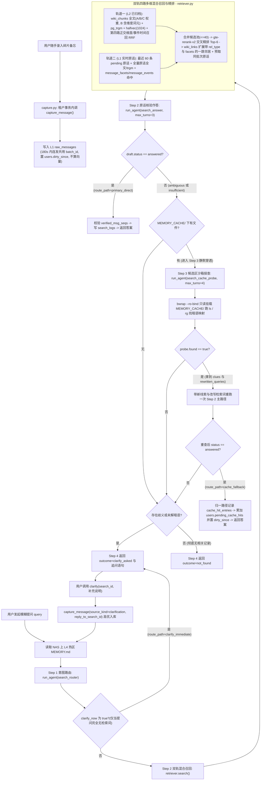

# Search Agent 与 Dreaming Agent 核心工作流程

本文梳理 Percolation 两个核心业务智能体的完整运行流程、分支判定条件、双轨混合召回算法以及数据一致性保障机制。对应实现位于 `code/percolation/`。

---

## 一、 碎片录入与 Search Agent 四步在线检索流程

### 1.1 设计原则

1. **录入端零阻力、零等待**：随手备忘通过 `capture.py` 直接调用数据库受控函数 `capture_message()` 原子落盘，180 秒内的连续输入自动归入同一 `batch_id` 并标记 `users.dirty_since`，**不在录入阶段计算向量或调用大模型**。
2. **先穿透候选区，最后才追问**：用户提问出现热区 `MEMORY.md` 未收录的个人暗语或首轮未命中时，严禁立刻向用户追问，必须先在受限只读沙箱内静默翻查 `MEMORY_CACHE/`；找到线索后自动改写检索词重查，只有穿透后依然歧义或无记录才发起一句话追问。
3. **原话唯一事实基准**：`wiki/*.md` 只充当缩小范围的导航地图，作答节点必须核对锚点对应的 `raw_messages` 逐字原话（含同一连发批次的前后消息），并在结构化输出中回填支撑答案的 `verified_msg_seqs`。

### 1.2 在线检索完整流程图

### 1.3 双轨混合召回（`retriever.py`）关键细节

- **为什么必须双轨并查**：夜间整理是异步定时运行的，用户下午刚记下的一句话下午就可能来问。此时该记录尚未进入 `wiki_chunks`，通过默认并查 `dream_status = 'pending'` 的近期原话（上限 60 条）以及原话表的全文/`trgm` 索引，可保证刚录入的备忘秒级可查。
- **轨道一（`wiki_chunks` 四路多维召回）**：
  1. **中文多级加权全文路**：使用库内 `percolation_tokens()` 将连续汉字切为重叠二字、英文数字保留整词，构造 OR 语义 `tsquery` 匹配 `tsv` 生成列（页面标题与 `aliases` 权重为 A，小节标题与多维标签词元 `facet_text` 为 B，正文为 C）。
  2. **残缺型号与单字回退路**：结合 `pg_trgm` 的 `word_similarity >= 0.35` 与 `ILIKE` 子串包含，同时解决半截英文型号（如 `cforc` 命中 `cforce 15.6`）与单个汉字查询无二字词元的问题。
  3. **半精度向量语义路**：当库内已有切片时，批量调用百炼 `text-embedding-v4`（1024 维）查询 `embedding <=> vec`（HNSW 余弦距离），切片 `embed_text` 已拼入页面 `page_type` 与 `facets` 摘要。
  4. **正交维度与事件日期路（第四路）**：`search_router` 依据受控词表（`config/facets.json` + `MEMORY_CACHE/facets.md`）与当前公历日期输出 `facet_filters` 与 `date_from`/`date_to`；Wiki 侧按切片级 `wiki_chunks.facets`（GIN `jsonb_path_ops`）的正交维度命中数排序召回对应小节（不跨小节串扰），Raw 侧查 `message_facets` 与 `message_events`（`time_field="any"` 时事件日期加分高于录入日期）；维度作为 RRF 软加权信号融入候选池，而明确日期区间在窗口内存在相应词法/维度命中（或无词法竞争者）时对已归档记录做范围硬筛，同时保留近期未归档 `pending` 原话进重排池兜底；若高分词法/维度命中全在日期窗口之外（如路由把日期算偏），则不误删正解，自动回退保留并标注核对提示。
- **RRF 融合 + Rerank 精排 + 类型化图邻居扩展**：各路召回累加 RRF 分数，取前 40 条送入 `gte-rerank-v2` 交叉精排保留 Top-6；随后顺着 `wiki_links` 正反向边查出最多 8 个关联主题页（附带 `rel_type` 关系类型与目标页 `facets`）一并附在上下文末尾。
- **异构多维拓扑导出（`graph.py`）**：无需外部图数据库，单次租户事务读取 `wiki_pages`、`page_facets`、`wiki_links`（及可选 `raw_messages`），组装 `page`、`facet:<dim>:<val>` 虚拟维度枢纽、`message` 与 `dangling` 节点及 `wiki_link`/`has_facet`/`anchors_msg` 有向边，支持多维交集筛选与 `WITH RECURSIVE` 1~3 跳邻域子图（`GET /v1/graph`、`GET /v1/facets` 与 `percolation_cli.py graph/facets`）。
- **遥测路径归一化**：模型在 `CacheProbe` 中汇报的文件路径可能写成 `slang.md` 或 `/workspace/MEMORY_CACHE/slang.md`，代码在写入 `search_logs.cache_hit_entries` 前统一归一为 `MEMORY_CACHE/<file>`，确保后续 Dreaming 热度统计准确命中。

---

## 二、 Dreaming Agent 五步夜间离线整理流程

### 2.1 设计原则

1. **按脏标记唤醒，拒绝全量轮询**：定时任务调用 `002_dream_queue.sql` 中的受控函数 `list_dirty_users()`，只拉取 `dirty_since IS NOT NULL` 或有待处理计数的活跃租户，并用会话级咨询锁防止同一租户重入。
2. **双节奏自动切换（`incremental` vs. `defrag`）**：
   - 日常默认走 **`incremental`（增量小改）**：只归档新消息、单点晋升近 14 天命中 ≥ 2 次的候选缓存词条。
   - 满足以下任一条件自动升级为 **`defrag`（全局重整）**：① `MEMORY.md` 行数超过软上限（180 行，即 200 行硬上限的 90%）；② `wiki_links` 中悬空死链数 ≥ 5；③ 距上次 `last_defrag_at`（或建号时间）已满 7 天。
3. **文件即本体，数据库即索引**：大模型只负责读写人类可读的 Markdown 文件；切片、算哈希、调向量接口与构建链接边表全部由确定性 Python 代码完成，分成不写库的 `plan_sync()` 和在调用方事务里执行的 `apply_sync()`，通过 `content_hash`（SHA-256）保证未改动的小节零重复向量开销。
4. **暂存写入 + 单事务发布**：整理全程写在独立 git worktree（`staging/<uid>/<run_id>`）里，检索只读主工作区和已发布索引，看不到半成品。收尾时先在暂存分支提交，再用**一个事务**刷新六张派生表、推进原话状态并登记 `users.workspace_head`，事务提交后主工作区 `merge --ff-only`。发布前任一步失败只需删掉暂存区，主工作区与索引从没被碰过；快进中断由下一次整理按 `workspace_head` 补齐；检索开头发现主工作区落后，也会在拿得到整理锁时先补快进再检索。
5. **锚点双向对账**：不盲信模型口头汇报的“已归档列表”，代码会扫描暂存区所有 Markdown 文件中实际落盘的 `#msg_N` 锚点与模型汇报取并集。
6. **可复现**：开跑前把工作区版本、库水位（`as_of`、最大原话序号、pending 集合）、代码/依赖/配置指纹与模式判定理由记进轨迹根 span；时间相关判断都用注入的 `as_of`。`trace_cli.py reproduce` 据此在 `replay-*` 租户里重建现场重跑对比。

### 2.2 夜间离线整理完整流程图

```mermaid
flowchart TD
  Trigger["夜间 03:30 定时器或手动 CLI dream"] --> ScanDirty["Phase 0: 调受控函数 list_dirty_users() 获取脏租户列表"]
  ScanDirty --> TryLock{"pg_try_advisory_lock(独占连接会话锁)"}
  TryLock -->|"已被占用"| SkipLocked["返回 status=locked 跳过"]
  TryLock -->|"获取成功"| Prepare["准备主工作区: 清残留 index.lock -> 按 workspace_head 补快进 -> 人工改动先提交并发布索引"]
  Prepare --> Anchor["记执行环境锚点: 工作区版本 / 库水位 as_of、max_msg_seq、pending 集合 / 代码与配置指纹"]
  Anchor --> LoadState["读取水位内 pending 原话、悬空链接数、MEMORY.md 行数与 as_of 前 14 天缓存命中统计"]

  LoadState --> ModeSelect["decide_mode(as_of): MEMORY.md > 180行 或 悬空链接 >= 5 或 距上次重整 >= 7天 -> defrag, 否则 incremental; 模式与理由写进锚点"]
  ModeSelect --> CheckNoop{"pending 为空 且 无晋升/重整需求?"}
  CheckNoop -->|"是"| FinalNoop["清脏标记并返回 status=noop"]
  CheckNoop -->|"否"| InsertRun["写入 dream_runs(status=running)"]

  InsertRun --> Staging["建暂存 worktree: staging/uid/run_id, 分支 dream/run_id"]
  Staging --> Phase1["Phase 1 上下文拼图归档(写暂存区): 按 batch_id 分组(每组<=40条, 不拆同批次)循环调 run_agent(dream_archive)"]
  Phase1 --> Phase1Detail["先读 read_skill(wiki-format) -> 结合热区与已有页面更新 wiki/*.md (补 aliases、标 confirmed/inferred 与 #msg_N) -> 澄清暗语写入 MEMORY_CACHE/*.md"]

  Phase1Detail --> Phase2["Phase 2 索引计划: plan_sync() 不写库"]
  Phase2 --> Phase2Detail["解析 frontmatter/小节/链接/锚点 -> content_hash 比对 -> 仅对新切片调 text-embedding-v4 -> 预算悬空链接"]

  Phase2Detail --> CheckTier{"需要冷热升降级?(有 >=2 次命中候选 或 热区 >180行 或 defrag)"}
  CheckTier -->|"否"| Phase4
  CheckTier -->|"是"| Phase3["Phase 3 冷热置换: run_agent(dream_tiering 或 dream_tiering_defrag)"]
  Phase3 --> Phase3Detail["14天内命中 >=2 次的 confirmed 词条移入 MEMORY.md; 超水位冷条目下沉回 MEMORY_CACHE/; defrag 按暂存区维度分布合并近义标签、合并重复页并修死链"]
  Phase3Detail --> CheckDefrag{"defrag?"}
  CheckDefrag -->|"是"| Replan["再算一次 plan_sync()(向量缓存复用)"]
  CheckDefrag -->|"否"| Phase4
  Replan --> Phase4

  Phase4["Phase 4 锚点对账: 扫描暂存区文件实际出现的 #msg_N 与模型汇报取并集"]
  Phase4 --> Commit["暂存分支 git commit"]
  Commit --> TxUpdate["Phase 5 单事务发布: apply_sync 刷新六张派生表 + raw_messages(archived / skipped) + 计数 + dream_runs(succeeded) + users.workspace_head"]
  TxUpdate --> FF["主工作区 merge --ff-only -> gc --auto -> 删暂存区"]
  FF -.->|"快进失败"| KeepBranch["保留分支并在结果 error 里注明, 下次 Prepare 或检索补快进"]

  Phase1 -.->|"发布前任一步抛异常"| Rollback["删暂存区与分支 -> dream_runs 记 failed (主工作区与索引未动, 原话保持 pending)"]
  Phase2 -.->|"发布前任一步抛异常"| Rollback
  Phase3 -.->|"发布前任一步抛异常"| Rollback
  TxUpdate -.->|"事务失败"| Rollback
```

### 2.3 真机实测性能基线（广州轻量服务器 + 百炼模型通道）

| 典型链路 | 模型调用次数 | 端到端耗时 | 备注 |
| --- | --- | --- | --- |
| 在线检索：主路径直达（`primary_direct`） | 3 ～ 5 次（`qwen3.8-flash`） | 6.8 ～ 9.0 秒 | 预取原话足够时作答节点 1 轮直出 |
| 在线检索：候选区沙箱穿透（`cache_fallback`） | 10 ～ 13 次（`qwen3.8-flash`） | 16 ～ 23 秒 | 含沙箱 `rg` 探查 + 改写检索词二次召回核验 |
| 夜间整理：增量归档 + 冷热晋升（`incremental`） | 4 ～ 10 次（`qwen3.8-max` 开思考） | 40 ～ 75 秒 | 系统提示词前缀稳定，百炼输入缓存命中率约 55%～68% |
